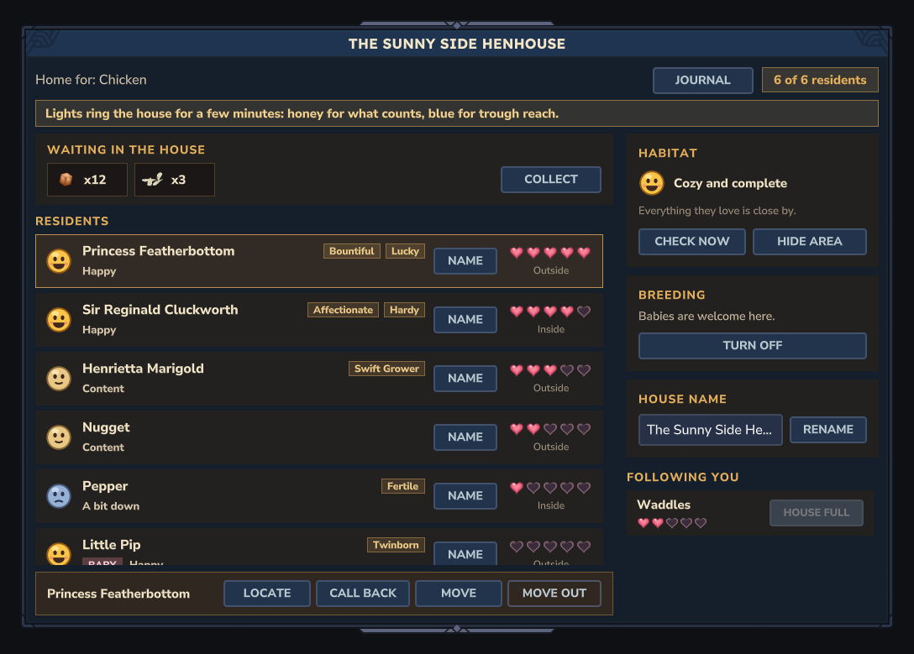

# fix-houseui: area lights, Check now, trait tooltips, Name

Branch `wave/fix-houseui`. Gibson's playtest list, the four house page items.

## What changed

1. **Show area / Hide area** (habitat card). Turns on two rings of glowing motes around the house, sent only to the
   player who pressed it (`SpawnParticleSystem` packets written to that player's own connection, one batched write per
   pulse; no one else gets them, no blocks are written).
   - **Honey ring** (`HouseBorder`): the edge of the habitat scan, a disc of `HabitatScanRadius` (default 12) columns
     around the house's origin block, drawn at radius + 0.5 so it sits on the outer edge of the last scanned column.
     That disc is what care reads for decorations, water, shade, and troughs with food that count for the habitat.
     Care scans `ScanBelow` 4 below to `ScanAbove` 10 above the house's height; the ring only shows the footprint.
   - **Sky-blue ring** (`HouseBorderTrough`): `TroughRange` (default 8) around the door. An animal asleep at home is
     fed from the door's position, so a trough with food inside this ring feeds it; an animal out and about eats
     from troughs within 8 blocks of wherever it is. Drawn only when it differs from the honey ring by 1.5 blocks or
     more.
   - Motes: a pair of soft glows every ~1.5 blocks, standing on the ground nearest the house's height (searched 10 above
     to 6 below), rising 0.5 blocks and fading over ~2.3 s; re-sent every 2 s. A point whose column is not in memory is
     left out. About 52 + 34 points by default: ~43 small packets a second, to one player only.
   - It **stays on after the page closes** (the page covers the screen; you need to walk around to look) and ends after
     3 minutes, when the player walks 24 blocks past the ring, changes world, logs out, presses Hide area, or turns on
     another house's area. One per player.
   - A notice says what it is: "Lights ring the house for a few minutes: honey for what counts, blue for trough reach."
     The button also has a tooltip explaining both rings.
2. **Check now** (habitat card): `CareApi.rescanHouse(world, house)` (new, care): the troughs within scan radius +
   trough range of this house are checked (gone ones drop their food, as the regular check does), then this one house is
   scanned whole and its record saved; a scan of it already under way is dropped. Bounded to one disc of
   `HabitatScanRadius` columns, sections in memory only, world thread, outside ticks (from the page's event handler).
   Once per 2 s per player (`RateLimit`); a second press inside that says "Give it a moment before looking again." The
   page then redraws with the new habitat card and notice "Took a fresh look around the house." If the area lights are
   on, their ground points are recomputed. Toys are not rescanned (behaviour's `ToyIndex` is package-private; see
   REQUESTS).
3. **Trait tooltips.** Each trait is now its own small honey pill on the name line (`#RTrait1`, `#RTrait2`), with the
   trait's name as text and `cozyranch_breeding.trait.<id>.desc` (from `Traits.json` `DescKey`) as its tooltip
   (`.TooltipText` set from Java with a `Message`, and `TextTooltipStyle: $C.@DefaultTextTooltipStyle` in the row,
   as vanilla's `Fields/TextRow.ui` and `TriggerVolumeInspectorPage` do). An id with no Traits.json entry shows
   humanised with "A trait this ranch has no notes on yet." Moving traits to the name line also fixed an overflow:
   with Baby + feed bonus + mood + personality + two traits, the second line ran under the buttons. A long name with
   traits is now cut with "..." on the row (the full name is in the bar under the list).
4. **Name** button on each resident row, only for the viewer's own animals or with `cozyranch.admin.manageany`
   (re-checked on press). Calls `TamingApi.openNamePage(playerRef, animalId)` exactly; the house page is not redrawn over
   whatever it opens. The stub does nothing until taming's work merges, so for now the press does nothing visible.

Other: `HouseDemo` residents now carry real trait ids (they were made-up words), so demo rows show real names and
tooltips. `resident.traits` lang key removed (unused). `habitat.unchecked.detail` mentions Check now.

## Files

- New: `houseui/HouseBorder.java` (rings, ground search, pulses), `houseui/HouseBorderSystem.java` (registered in
  `HouseUiFeature`; queues a pulse per world every 2 s, idle when nobody has lights on), `houseui/RateLimit.java`,
  `Server/Particles/CozyRanch/HouseBorder*.particlesystem` and `Spawners/HouseBorder*.particlespawner` (vanilla
  `Particles/Textures/Basic/Glow.png`, so no `Common/Particles` files).
- Changed: `HousePage`, `HousePageLayout`, `HouseView`, `HouseSource` (`rescan`, `demo`), `HouseDemo`, `UiOut`
  (`tooltip`), `ServerUiOut`, `HousePage.ui`, `HouseResidentRow.ui`, `cozyranch_houseui.lang`; care: `CareApi.rescanHouse`,
  `CareWorld.rescanHouse` (addition only).
- Bot event data: `{"Action":"Refresh"}`, `{"Action":"Border"}`, `{"Action":"Name","Animal":"<uuid>"}`.

## How it was verified

- `.\gradlew.bat build` green; `node tools/check-lang.mjs`: 0 missing.
- `asset_validate` valid (0 errors), `ui_check_java` valid (0 errors, 0 warnings).
- `test_run houseui`: 2 cases, 17 steps green. Goldens **updated on purpose, all 13**: every page gains the Check now /
  Show area row in the habitat card, rows gain Name and trait pills, demo traits are real. **Two new**:
  `houseui-border` (lights on, Hide area, the notice) and `houseui-notraits` (no-trait rows, after Check now).
  The cases are generated by `HousePageLayoutTest` from the layout (`HOUSEUI_WRITE_CASES=true`).
- Pictures looked at: `houseui-border`, `-full`, `-long` (Baby + feed + mood + personality + two traits + 24-character
  names: fits now; it overflowed before the fix), `-notraits`, `-unchecked`. Copies in `notes/pictures/fix-houseui/`.
- Unit tests (8 new in `HousePageLayoutTest`): trait pills and their description tooltips, no-trait rows hide both,
  Traits.json lookup and unknown ids, Name only for own animals, Show/Hide label, refresh rate limit (2 s, per player,
  refused presses do not reset the wait), ring spacing and radius, ground search (flat, roof, hill, unloaded, drop),
  border ends with time or distance.
- `particle_check` both systems: visible, no errors. `particle_render`:
  `pictures/fix-houseui/particle-houseborder.png`, `particle-houseborder-trough.png` (soft honey / sky-blue glows,
  readable on dark and bright).

## What nobody has seen in the client

- **The area lights.** Not run on a server (no port for this role). Whether the motes show, how bright they are in
  daylight, whether the 2 s re-send leaves visible gaps or double-ups, and whether ~86 particle systems at once are
  culled at a distance (`CullDistance` 48 set) are all unseen. If they are too faint by day, raise `Scale` or switch to
  `BlendAdd` at night only.
- **Tooltips**: `ui_render` does not draw hover. Whether a Label inside the row Button receives hover (and so shows
  its tooltip) is unproven; vanilla puts tooltips on Labels, not inside Buttons. If not, give the pills
  `HitTestVisible: true` or move the tooltip to a wrapping Group. A click on a trait pill may not select the row.
- **Name**: a TextButton inside the row Button. Whether pressing it also fires the row's Select is unknown; both are
  harmless. The naming page itself is taming's.
- Check now on a real house: the scan is the same code care's admin `/ranch care run` uses, but for one house.

## REQUESTS

- **behaviour**: a public way to rescan one house's toys now, e.g. `public static void BehaviourApi.rescanToys(World,
  HouseRecord)` calling `ToyIndex.scan` for that house; houseui would call it from Check now. Not needed for the
  habitat card (it shows no toys).
- **coordinator**: `HousePageLayoutTest.PROJECT` and `tests/hytale/houseui.test.json` name this worktree
  (`_worktrees/CozyTales-Ranching-fix-houseui`); rewrite the path at merge as before (or regenerate with
  `HOUSEUI_WRITE_CASES=true` in the main checkout after changing `PROJECT`).
- **coordinator**: ownership of `houseui/RateLimit.java`, `HouseBorder*.java` falls under `houseui/**`; the particle files
  are the contract's `Server/Particles/CozyRanch/HouseBorder*` plus their `Spawners/` subfolder.
- **taming**: the house page calls `TamingApi.openNamePage(playerRef, animalId)` for residents of the viewer's own (or,
  for `cozyranch.admin.manageany`, anyone's) animals; the page leaves the screen to whatever that opens.
