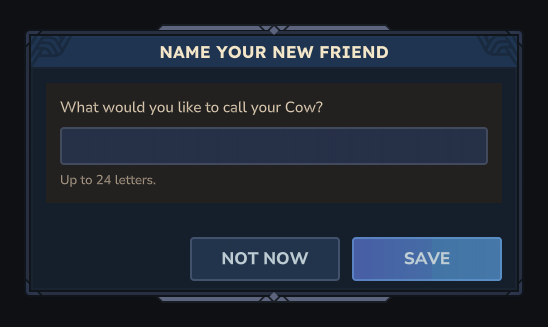
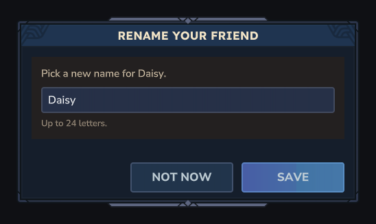
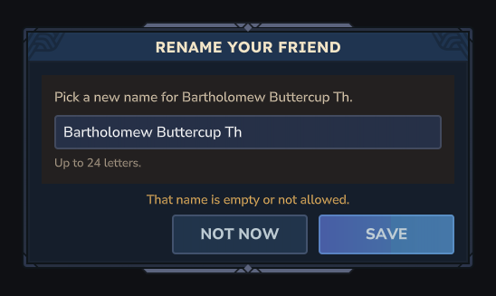

# fix-taming (fix wave 1)

Branch `wave/fix-taming`. Gibson's four taming reports from the first playtest. No vanilla asset is edited or
overridden; everything is Java in `taming/`, one new `.ui`, and lines in `cozyranch_taming.lang`.

## 1. No prompt on wild animals: fixed

**What the player saw, read in the source and measured with the test player.**

| Species (wild roles) | Vanilla says | What arrived at the client before the fix |
| --- | --- | --- |
| Cow, Chicken, Pig, Sheep (and their babies, `Pig_Wild`, `Chicken_Desert`, our `CozyRanchWild_*` rares) | `Template_Animal_Neutral`, `IsTameable: true`: `SetInteractable` with hint `server.interactionHints.tame` unless asleep | the hint, then an **empty** Interactable update one packet later. Final state: no hint text |
| Frog_Green, Frog_Blue, Frog_Orange, purple rare | `Template_Beasts_Passive_Critter` has no `InteractionInstruction` | nothing: never interactable, and they flee before Use reach |

Root cause (0.7 source): `StateSupport.setInteractable` sends the role's hint once, in the tick that adds the
`Interactable` marker, and remembers it in `lastHint` (one per NPC, not per player). The marker's replication
(`MarkerReplicationSystems.EntityTrackerUpdate`) then queues `new InteractableUpdate()` (null hint) to every viewer,
and again to every player who sees the animal later. The role never sends its hint again because it never changes.
Seen with the bot in Adventure mode: `{"interactionHint": "server.interactionHints.tame"}` then `{}` for every
species. (Our own ranch roles escape this by luck: their hint changes between feed and pet, so it is resent.)
It is a vanilla bug that also hides "Press F to tame" in plain vanilla.

**Fix** (`taming/WildPrompts.java`):

- `Repair`, an entity ticking system over `Visible + Interactable + NPCEntity`, ordered after
  `RoleSystems.BehaviourTickSystem` and the `QUEUE_UPDATE_GROUP`, before `SendPackets`. For each player who sees the
  animal it looks at what is queued for that animal this tick; if the last Interactable update is vanilla's (empty or
  "tame"), it queues ours after it. The role keeps quiet afterwards (its `lastHint` is unchanged), so ours sticks.
  Only supported wild roles with no ranch marker, species enabled, `CompatGuard.isManageable`.
- The hint depends on the player's held item: a food the species eats gives **"Press [{key}] to befriend"**
  (`hint.befriend`); anything else **"Press [{key}] to say hello"** (`hint.greet`), which on Use says "sniffs your
  empty hand" / "not interested", so the player learns to bring food. I kept a prompt without food rather than none,
  so the player can find out that the animal can be befriended at all.
- `OnHotbar` (`InventorySetActiveSlotEvent` on players): a slot change re-sends the hint for wild interactable
  animals within 12 blocks, so the prompt switches between hello and befriend as the player changes item.
- **Frogs:** a Use prompt would be wrong (they flee before Use reach and the jar works on right-click). Chosen: the jar's
  tooltip already says "Right-click a frog to offer one", and the first time a player switches to the Jar of Crickets
  in a server run they get one chat line: "Right-click a frog to offer it crickets. Frogs are shy, so stay a few steps
  away." (`crickets.tip`).

Cost: one map lookup per viewer per interactable NPC per tick (only NPCs near players carry the marker; vanilla's own
replication walks the same set), plus a small array copy when that animal has updates queued. Real work only when an
Interactable update is queued, and on hotbar changes. No entity scans.

Measured on port 15542 (bot, Adventure, holding wheat): each of Cow, Pig, Sheep, Chicken got
`tame` then `{}` then ours in the same packet (`befriend` for cow, sheep, chicken; `greet` for the pig, which does not
eat wheat). After the bot left and rejoined, each got `{}` then ours, and no later vanilla update replaced it.

## 2. Petting spam: fixed

A second pet the same **in-game day** (the world's game clock, as before; `lastPettedAtMs` unchanged, so
`CareRules.pettedRecently` still reads it) now gives only "{animal} has already had a pet today." No hearts
particles, animation, sound or friendship. The first pet of the day is unchanged. The day turns over at midnight on
the game clock (a pet at 23:59 and one at 00:01 are two days). `pet.again` is gone from the lang file.

## 3. Naming page: done

`TamingApi.openNamePage(PlayerRef, UUID)` (signature unchanged) opens `NamePage` (`taming/NamePage.java`,
`Common/UI/Custom/CozyRanch/NamePage.ui`, HouseStyles colours and card). A text field prefilled with the current
name, **Save** (also Enter, `Validating`) and **Not now**. Same rules as `/ranch name` (`TamingRules.cleanName`, 24).
An empty name keeps the page open with "That name is empty or not allowed." Saving sets the record, saves, updates
the plate on the animal's world thread and says "Named it {name}.". It opens only for the owner (or
`cozyranch.admin.manageany`) with `cozyranch.name`.

It opens by itself right after a wild animal is befriended, and after claiming an adopted animal that has no name yet.
`/ranch name <name>` is kept. All text is set from Java with `.TextSpans`; ids are letters only.

## 4. Nameplates: done

`TamingApi.nameplateText` = `TamingRules.nameplateText(name, RanchConfig.showNameplates())`: the name, or null when
the switch is off. **An unnamed animal has no plate** (every new friend is asked for a name now, and a species word
over every chicken would be noise).

`taming/Nameplates.java` puts, updates or removes the plate. It runs on: tame (none until named), claim, the name page,
`/ranch name`, feeding and petting an owned animal, and `Nameplates.OnLoad`, a `RefSystem` on the ranch marker that
runs once each time an owned animal's entity enters a world (chunk load, spawn, role swap). So turning the switch off
removes old plates the next time each animal loads or is fed or petted; animals already loaded keep theirs until then.

Measured on port 15542: `/ranch name Daisy` on a claimed cow sent `{"text": "Daisy"}`. With `ShowNameplates: false` and
`/ranch reload`, a chunk reload brought the cow back with no plate; with it back on, the reload brought `Daisy` back.

## Verified

- `.\gradlew.bat build` green. `TamingRulesTest` 14/14, new: second pet the same day, day boundary, name cleaning
  (control characters, 24-character cut, emoji), nameplate with the switch on and off, prompt per held food.
- `asset_validate` valid (0 errors), `ui_check_java` valid, `node tools/check-lang.mjs` 0 missing.
- `tests/hytale/taming.test.json`: new cases "name page gate" and "name page" (three `ui_render` goldens with the
  commands `NamePage.build()` sends). Green when run with the worktree's path; the file now uses the
  `CozyTales-Ranching/` path like every other case, so it runs on main after the merge.
- Live run with the headless player on port 15542, server and bot stopped afterwards; no exceptions in the log.

## Not exercised, nobody has seen it in the client

- The prompt text in the client. The packets are right; whether the client draws "Press [F] to befriend" over a
  cow is for Gibson to look at.
- `OnHotbar`: the bot cannot change slot (the server kicks a slot change without an interaction). Picking up food into
  the slot already held does not refresh the prompt until the next slot change or rejoin.
- The name page opening after a real tame or claim, typing in it, Enter, Save and Not now: bots cannot press Use on
  an entity, and no command opens the page. Rendered offline only; the event wiring is copied from the house page's
  rename field.
- The cricket tip (needs a slot change).
- Petting once a day: rule unit-tested; the in-game flow needs Use.

## REQUESTS

None needed. FYI for houseui: the rename button calls `TamingApi.openNamePage(playerRef, animalId)` and should not
rebuild the house page over it (the name page replaces it, like the journal). For behaviour/animal: if any other place
creates a ranch animal entity with a name, `Nameplates.OnLoad` already covers it, nothing to call.
