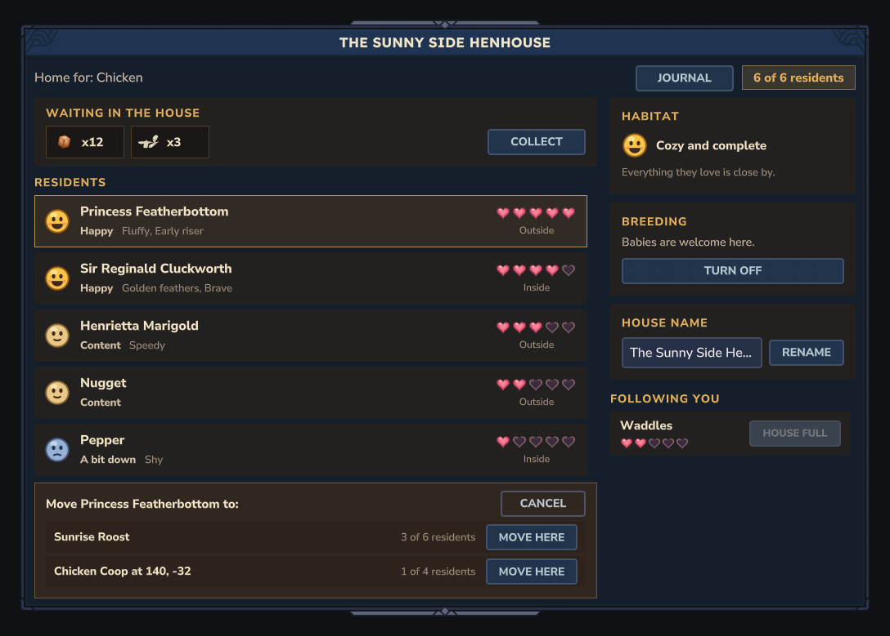
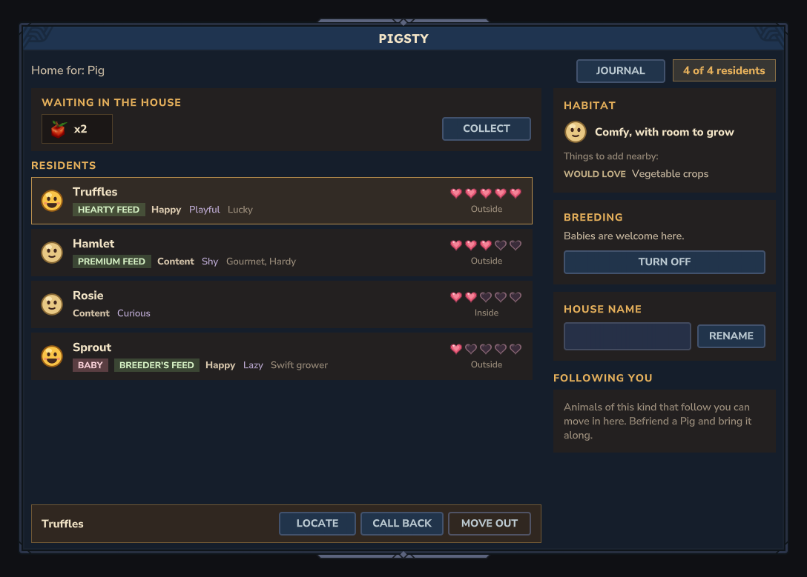

# houseui: the house page

Design doc section 13. Opened through `Ranch.housePages().open(playerRef, store, house)`, which
`HouseUiFeature.register` installs (`HousePage::open`). One page, rebuilt whole after every action.

## Wave 3: products, resident actions, journal, personality and feed bonus

Branch `wave/houseui`. Panel grew to 1040 x 720 to make room.

- **Products** card at the top of the left column ("Waiting in the house"): one chip per item kind (vanilla
  `ItemIcon` with `ShowItemTooltip`, so hovering names the item, and "x{count}"), from
  `Ranch.produce().stored(houseId)` in its order. Up to five chips; with six or more kinds, four chips and
  "+N more". Empty: "Nothing yet. Happy residents leave little gifts here." and Collect is disabled.
  **Collect** calls `Ranch.produce().collect(...)`, rebuilds, and puts one line in the notice bar: "Into your
  bags: 14.", "Nothing to collect yet.", "Your bags are full.", or, when only milk is left, "The milk waits for
  empty buckets, one each." While any `*Container_Bucket_State_Filled*` item waits, a honey hint under the chips
  says milk needs one empty bucket each.
- **Selecting a resident.** Rows are now buttons (vanilla's `#List[i]` row-button pattern, as in
  `CommandListPage`): a click selects the row (honey frame) and the bar under the list shows that resident's
  name and **Locate**, **Call back** (`resummon`), **Move** and **Move out**. The first resident is selected by
  default, so the bar is never empty. I chose this over four more buttons per row (the old rows were already
  full at two); rows now read cleanly and the actions sit in one place. Decision to review.
- **Locate** sends a chat line (`Locate.describe`): "inside the house, snug and safe" when STORED; "wandered
  off, Call back brings it home" when MISSING; "in another world"; "right beside you" under 4 blocks; else
  "{name} is 34 blocks northeast of you" from the live entity (north is -Z, east +X), or "was last seen ..."
  from the record's last position when the entity is not loaded.
- **Move** opens a picker in place of the bar: the owner's other houses of the same species, **same world**,
  with room (`HouseView.canMoveTo`), most free room first, at most three (no scrollbar). Unnamed houses read
  "Chicken Coop at 140, -32" so two coops differ. **Move here** calls `HouseService.assign(actor, animal,
  target)`; the page re-checks the target is still a valid one first. The Move button is hidden when there is
  no such house.
- **Journal** button in the header: `Ranch.journal().open(playerRef, store, house.speciesId)`; when it returns
  false the player gets "The Rancher's Journal is not ready yet." in chat and the page stays. When it opens,
  the house page is not rebuilt over it.
- **Personality** (lilac, after the mood word) from `cozyranch_behaviour.personality.<id>`, and an active
  **feed bonus** pill (green, "Hearty feed", "Sweet feed", "Breeder's feed", "Premium feed"; any other id
  humanised) when `feedBonus` is set and `feedBonusUntilMs` is in the future.
- **Permissions.** Collect and Locate check owner with `cozyranch.house.manage`, or
  `cozyranch.admin.manageany`, in the page; Journal checks `cozyranch.journal`; Move, Call back, Move out keep
  going through `HouseService`, which checks the same.

Bot event data for the new buttons: `{"Action":"Select|Locate|PickHouse|CallBack|MoveOut","Animal":"<uuid>"}`,
`{"Action":"MoveTo","Animal":"<uuid>","House":"<uuid>"}`, `{"Action":"CancelMove"}`, `{"Action":"Collect"}`,
`{"Action":"Journal"}`.

### Pictures (all `ui_render` with the commands `HousePageLayout` sends, opened and checked)

| Picture | State |
| --- | --- |
| `houseui-empty.png`, `houseui-typical.png` | no products (empty state, Collect disabled) |
| `houseui-products.png` | seven kinds, counts up to 1250: four chips and "+3 more" |
| `houseui-milk.png`, `houseui-collected.png` | milk waiting, the bucket hint; after Collect with no buckets |
| `houseui-full.png` | full coop, first hen selected, all four actions |
| `houseui-move.png` | the move picker (the full fourth coop is left out) |
| `houseui-personality.png`, `-preview.png` | personalities and feed bonuses, one bonus expired and hidden |
| `houseui-long.png`, `-preview.png` | 24-character names everywhere, picker open |

The `-preview` pictures replace the personality keys with the names behaviour will give them; the goldens show
the raw keys (`cozyranch_behaviour.personality.playful`) because behaviour's lang file is not in this
worktree. `live-full.png` and `live-missing.png` are the coordinator's bot run of the **old** layout.

### Faked, unproven, decisions

- `HouseDemo` gained products, other houses of the owner (`otherHouse`), personalities, feed bonuses and
  made-up positions for Locate. Its Collect hands over everything but milk and touches no inventory. Its
  Journal is the real `Ranch.journal()`. New scenarios: `/ranch housepage products|milk|move|personality|long`.
- Live product storage, collect and the journal are stand-ins in this worktree (`NONE`): the live page shows
  the empty products card and the journal chat line until produce and journal merge.
- The milk chip shows a placeholder in `ui_render` (it cannot resolve the state item id
  `*Container_Bucket_State_Filled_Milk`). Whether the client's `ItemIcon` draws a state item id is unproven;
  look at it in game. If it does not, the fix is local (map to the base item's icon with an `AssetImage`).
- Not run on a server (no port for this role). Hover and pressed states of the row buttons, and whether a
  click on a row's labels reaches the row button (vanilla does the same with labels inside a `Button`), need
  the client.
- Decisions: selection bar instead of per-row buttons; Move limited to the same world (an animal moved to a
  house in another world would stay where it is); picker capped at three houses; Locate and Collect need the
  manage permission like every other house action.
- Cost: nothing per tick. Per build: one `stored(houseId)`, `ownedBy(owner)` and one `inHouse` per other house
  of that owner (record indexes). Locate: one entity lookup by UUID.
- Unit tests (`HousePageLayoutTest`, 15): chips and "+N more", Collect disabled when empty, milk stays after a
  demo Collect, Move hidden without targets, picker rows, default selection, personality and feed bonus
  (expired hidden), move-target rules, Locate distances and compass. The test file paths now name this
  worktree (`_worktrees/CozyTales-Ranching-houseui`); rewrite at merge as before.

## What the page shows

- **Title**: the house's custom name, else the house item's own name (`Item.getTranslationKey()` of the
  placed block, falling back to the species' `HouseBlock`), else "{species} House".
- **Header**: "Home for: {species}" and a pill "{n} of {capacity} residents".
- **Notice bar** (only after an action): the result of the last button, e.g. "Buttercup moved in!" or,
  while `HouseService.UNAVAILABLE` is installed, "The house is still settling in. Try again soon."
- **Residents** (left, scrolls): a face for happiness (happy at 0.7 and up, content from 0.4, "a bit down"
  below) with the word beside it, name (or the species name), a pink BABY tag, up to two traits, five hearts,
  Inside / Outside / Wandered off (`HouseService.isInside`, record `MISSING`). Since wave 3 the row is a
  button that selects the resident; **Call back** (`resummon`), **Move out** (`unassign`), Locate and Move live
  in the bar under the list. Adults first, then by tame/birth time, so rows keep their order.
  An empty house shows a friendly invitation card instead.
- **Habitat** card: not checked yet (`habitatScannedAtMs == 0`); "Cozy and complete" (requirements met,
  score at least 0.85); "Comfy, with room to grow" (met); "Missing something important" (not met, or a
  required feature is missing). Missing ids are split by the species' `HabitatRequires`: NEEDS (rose) first,
  then WOULD LOVE. Names come from `cozyranch_houseui.habitat.<id>`; every id in the five species files
  has one (a unit test fails if a species gains an id without a key).
- **Breeding** card: state sentence and a Turn on / Turn off button (`setBreeding`).
- **House name** card: text field (24 characters, same limit as animal names) and Rename (`rename`); an
  empty field puts the usual name back (`rename(..., null)`).
- **Following you**: the player's own animals of this species with `following`, no house, state ACTIVE,
  each with hearts and **Move in** (`assign`). When the house is full the button reads HOUSE FULL and is
  disabled. With nobody following, a hint says how to bring one.

Every action goes through `Ranch.houseService()`; any result other than OK becomes a notice
(`cozyranch_houseui.result.<result>`), so `UNAVAILABLE` shows a message and nothing crashes. The page
checks that a Move in target really is one of the player's followers and that Move out / Call back targets
live in this house before calling the service; ownership and permissions are the service's job.

## Files

- `java/.../houseui/`: `HouseUiFeature` (installs the opener), `HousePage` (the `InteractiveCustomUIPage`,
  event codec `Action` / `Animal` / `@Name`), `HouseView` (what to show, from records; no server types),
  `HousePageLayout` (view to commands and bindings), `UiOut` + `ServerUiOut` + `Txt` (so the layout runs in
  unit tests), `HouseSource` (live registries, produce, journal, or the demo), `HouseDemo` (made-up houses and
  a stand-in service), `Locate` (the Locate chat line), `HousePageTestCommand` (`/ranch housepage`).
- `Common/UI/Custom/CozyRanch/`: `HousePage.ui`, `HouseResidentRow.ui`, `HouseFollowerRow.ui`,
  `HouseMissingRow.ui`, `HouseProductChip.ui`, `HouseMoveRow.ui`, `HouseStyles.ui` (shared colours and label styles), and five icons drawn for this
  page (`HouseHeartFull/Empty`, `HouseFaceHappy/Okay/Sad`, 1x and @2x; the script is
  `notes/pictures/houseui/icons.py`).
- `cozyranch_houseui.lang`, `tests/hytale/houseui.test.json` and its seven goldens,
  `src/test/java/.../houseui/HousePageLayoutTest.java`.

Look: the vanilla `DecoratedContainer` like CozyTales-Fishing's pages, with warm creams, honey headings and
brown cards on top of it. Page and row ids never repeat (row ids start with R, F or M) and rows are
addressed through their list (`#ResidentList[2] #RName`).

## The test command (for the coordinator's headless player)

`/ranch housepage [typical|full|empty|unchecked|missing|breedingoff]`, needs `cozyranch.admin`. Opens the
real page code on a `HouseDemo`: records that exist only in that object (never in the registries, nothing
saved, no world touched) and a **stand-in house service** that changes them, so every button works and
re-renders: Move in moves Daisy into the cow barn, Move out puts a resident back among the followers, and so
on. Bot event data: `{"Action":"MoveIn|MoveOut|CallBack","Animal":"<uuid>"}`, `{"Action":"Breeding"}`,
`{"Action":"Rename","@Name":"Sunny Roost"}`. The demo's animal ids are fixed
(`UUID.nameUUIDFromBytes("demo-animal-<species>-<index>")`); `bot_ui` shows them in the bindings.

## How the render test stays honest

`HousePageLayoutTest` renders each demo scenario through the same `HousePageLayout` the server uses, into
a recorder that writes the MCP's command format, and fails the Gradle build if `houseui.test.json` does not
contain exactly those command lists. After a layout change: `$env:HOUSEUI_WRITE_CASES='true'; .\gradlew.bat
test`, look at the renders, then `test_run` with `updateGoldens`. Only the event bindings are not in the
renders (they are not commands).

## What is fake, what is unproven

- Fake: `HouseDemo` and its service (test command only). The live page uses whatever `Ranch` holds; until
  the house role's work is merged, actions answer UNAVAILABLE and show the notice, and `isInside` is false.
- Never seen in the client: hover and pressed states, the scrollbars, the text field, whether the client
  resolves a translated parameter inside a translated message (`Message.param(name, Message)`, used for the
  species name in the header, hints and results; the server API exists for exactly this), and the icons at
  window sizes other than 1080. Not run on a server: no port for this role. The coordinator's bot run is the
  first time the commands and bindings meet a real server.
- Trait ids are shown humanised (`golden_feathers` as "Golden feathers"): breeding owns `Traits.json` and
  its lang keys, and their pattern is not known to me yet (see REQUESTS).
- Cost: nothing per tick. Building the page reads the house, `inHouse` and `ownedBy` once per open and once
  per button press.

## REQUESTS

Wave 3:
- behaviour: an en-US key `cozyranch_behaviour.personality.<id>` for every id it writes to
  `AnimalRecord.personality` (the page sends exactly that key; short single words read best on the row).
- produce: the page treats any stored id starting with `*Container_Bucket_State_Filled` as needing an empty
  bucket (the hint and the result line). If milk is stored under another id, tell houseui. `collect` should
  return only what really moved, so "Into your bags: N" is right.
- journal: the page checks `cozyranch.journal` before calling `Ranch.journal().open`; if the opener checks it
  too, that is fine.
- Ownership: two new documents, `HouseProductChip.ui` and `HouseMoveRow.ui`, fall under `House*.ui`;
  `src/test/java/.../houseui/**` is still houseui's (see below).

Wave 2 (kept):
- Ownership: `src/test/java/.../houseui/**` (my unit test) and `Common/UI/Custom/CozyRanch/House*.png`
  (the page's five icons, beside the `.ui` documents) are not in the contract's table; please add them to houseui.
- breeding: tell houseui the lang key of a trait's display name (e.g. `cozyranch_breeding.trait.<id>`); the
  page will switch from humanised ids to that key.
- care: any new habitat feature id needs a `cozyranch_houseui.habitat.<id>` line (the unit test lists
  any that are missing for the bundled species).
