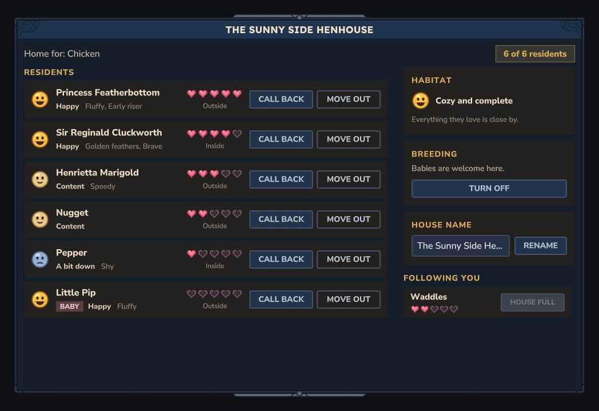

# houseui: the house page

Design doc section 13. Opened through `Ranch.housePages().open(playerRef, store, house)`, which
`HouseUiFeature.register` installs (`HousePage::open`). One page, rebuilt whole after every action.

## What the page shows

- **Title**: the house's custom name, else the house item's own name (`Item.getTranslationKey()` of the
  placed block, falling back to the species' `HouseBlock`), else "{species} House".
- **Header**: "Home for: {species}" and a pill "{n} of {capacity} residents".
- **Notice bar** (only after an action): the result of the last button, e.g. "Buttercup moved in!" or,
  while `HouseService.UNAVAILABLE` is installed, "The house is still settling in. Try again soon."
- **Residents** (left, scrolls): a face for happiness (happy at 0.7 and up, content from 0.4, "a bit down"
  below) with the word beside it, name (or the species name), a pink BABY tag, up to two traits, five hearts,
  Inside / Outside / Wandered off (`HouseService.isInside`, record `MISSING`), and **Call back**
  (`resummon`) and **Move out** (`unassign`). Adults first, then by tame/birth time, so rows keep their order.
  An empty house shows a friendly invitation card instead.
- **Habitat** card: not checked yet (`habitatScannedAtMs == 0`); "Cozy and complete" (requirements met,
  score at least 0.85); "Comfy, with room to grow" (met); "Missing something important" (not met, or a
  required feature is missing). Missing ids are split by the species' `HabitatRequires`: NEEDS (rose) first,
  then WOULD LOVE. Names come from `cozyranch_houseui.habitat.<id>`; every id in the five species files
  has one (a unit test fails if a species gains an id without a key).
- **Breeding** card: state sentence and a Turn on / Turn off button (`setBreeding`).
- **House name** card: text field (24 characters, same limit as animal names) and Rename (`rename`); an
  empty field puts the usual name back (`rename(..., null)`).
- **Following you**: the player's own animals of this species with `following`, no house, state ACTIVE,
  each with hearts and **Move in** (`assign`). When the house is full the button reads HOUSE FULL and is
  disabled. With nobody following, a hint says how to bring one.

Every action goes through `Ranch.houseService()`; any result other than OK becomes a notice
(`cozyranch_houseui.result.<result>`), so `UNAVAILABLE` shows a message and nothing crashes. The page
checks that a Move in target really is one of the player's followers and that Move out / Call back targets
live in this house before calling the service; ownership and permissions are the service's job.

## Files

- `java/.../houseui/`: `HouseUiFeature` (installs the opener), `HousePage` (the `InteractiveCustomUIPage`,
  event codec `Action` / `Animal` / `@Name`), `HouseView` (what to show, from records; no server types),
  `HousePageLayout` (view to commands and bindings), `UiOut` + `ServerUiOut` + `Txt` (so the layout runs in
  unit tests), `HouseSource` (live registries or the demo), `HouseDemo` (made-up houses and a stand-in
  service), `HousePageTestCommand` (`/ranch housepage`).
- `Common/UI/Custom/CozyRanch/`: `HousePage.ui`, `HouseResidentRow.ui`, `HouseFollowerRow.ui`,
  `HouseMissingRow.ui`, `HouseStyles.ui` (shared colours and label styles), and five icons drawn for this
  page (`HouseHeartFull/Empty`, `HouseFaceHappy/Okay/Sad`, 1x and @2x; the script is
  `notes/pictures/houseui/icons.py`).
- `cozyranch_houseui.lang`, `tests/hytale/houseui.test.json` and its seven goldens,
  `src/test/java/.../houseui/HousePageLayoutTest.java`.

Look: the vanilla `DecoratedContainer` like CozyTales-Fishing's pages, with warm creams, honey headings and
brown cards on top of it. Page and row ids never repeat (row ids start with R, F or M) and rows are
addressed through their list (`#ResidentList[2] #RName`).

## The test command (for the coordinator's headless player)

`/ranch housepage [typical|full|empty|unchecked|missing|breedingoff]`, needs `cozyranch.admin`. Opens the
real page code on a `HouseDemo`: records that exist only in that object (never in the registries, nothing
saved, no world touched) and a **stand-in house service** that changes them, so every button works and
re-renders: Move in moves Daisy into the cow barn, Move out puts a resident back among the followers, and so
on. Bot event data: `{"Action":"MoveIn|MoveOut|CallBack","Animal":"<uuid>"}`, `{"Action":"Breeding"}`,
`{"Action":"Rename","@Name":"Sunny Roost"}`. The demo's animal ids are fixed
(`UUID.nameUUIDFromBytes("demo-animal-<species>-<index>")`); `bot_ui` shows them in the bindings.

## How the render test stays honest

`HousePageLayoutTest` renders each demo scenario through the same `HousePageLayout` the server uses, into
a recorder that writes the MCP's command format, and fails the Gradle build if `houseui.test.json` does not
contain exactly those command lists. After a layout change: `$env:HOUSEUI_WRITE_CASES='true'; .\gradlew.bat
test`, look at the renders, then `test_run` with `updateGoldens`. Only the event bindings are not in the
renders (they are not commands).

## What is fake, what is unproven

- Fake: `HouseDemo` and its service (test command only). The live page uses whatever `Ranch` holds; until
  the house role's work is merged, actions answer UNAVAILABLE and show the notice, and `isInside` is false.
- Never seen in the client: hover and pressed states, the scrollbars, the text field, whether the client
  resolves a translated parameter inside a translated message (`Message.param(name, Message)`, used for the
  species name in the header, hints and results; the server API exists for exactly this), and the icons at
  window sizes other than 1080. Not run on a server: no port for this role. The coordinator's bot run is the
  first time the commands and bindings meet a real server.
- Trait ids are shown humanised (`golden_feathers` as "Golden feathers"): breeding owns `Traits.json` and
  its lang keys, and their pattern is not known to me yet (see REQUESTS).
- Cost: nothing per tick. Building the page reads the house, `inHouse` and `ownedBy` once per open and once
  per button press.

## REQUESTS

- `RanchCommand`: `this.addSubCommand(new com.hexvane.cozytalesranching.houseui.HousePageTestCommand());`
- Ownership: `src/test/java/.../houseui/**` (my unit test) and `Common/UI/Custom/CozyRanch/House*.png`
  (the page's five icons, beside the `.ui` documents) are not in the contract's table; please add them to houseui.
- breeding: tell houseui the lang key of a trait's display name (e.g. `cozyranch_breeding.trait.<id>`); the
  page will switch from humanised ids to that key.
- care: any new habitat feature id needs a `cozyranch_houseui.habitat.<id>` line (the unit test lists
  any that are missing for the bundled species).
